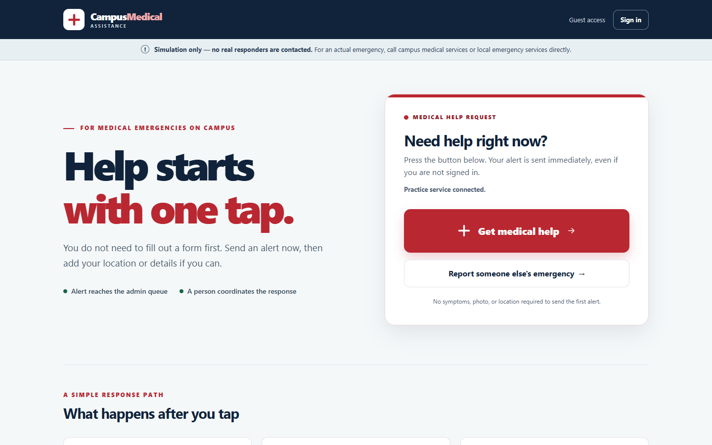
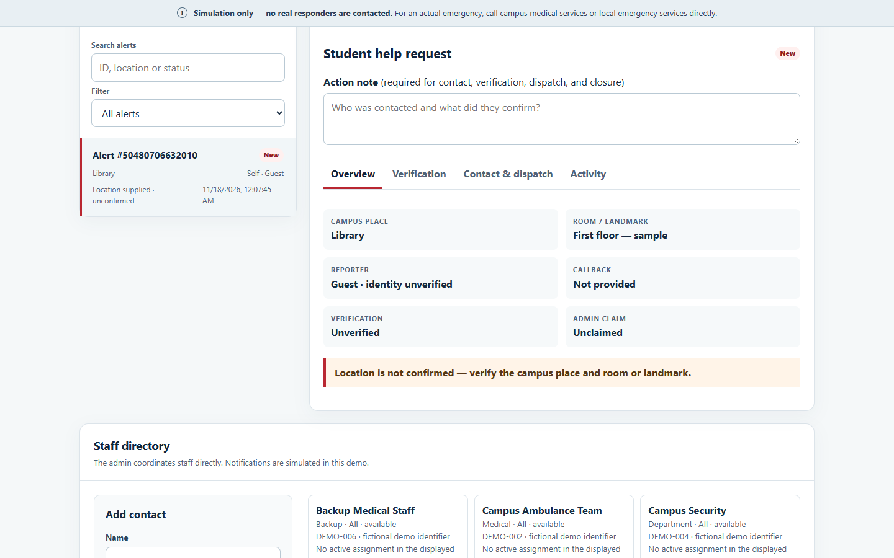
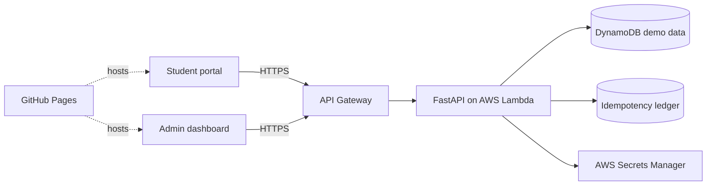

<div align="center">

# Campus Medical Assistance

**A cloud-based campus medical response workflow, built for a college demonstration.**

[Open the live project](https://abhay-coding.github.io/Emergency_Response_System/medical.html) · [Run locally](docs/LOCAL_DEMO.md) · [Report an issue](../../issues)


</div>

> **Simulation only:** The project does not contact medical services or dispatch responders. For a real emergency, contact campus medical services or local emergency services directly.

## The idea

Students can submit a medical assistance request with one tap, including as a guest. They can then share a location and follow the request's progress. An administrator reviews the alert, records verification notes, and coordinates a **simulated** response using fictional contacts.

| Student experience | Operations dashboard |
| --- | --- |
|  |  |

*Screenshots use fictional data from an isolated local instance.*

## How it works

1. A student or bystander sends a request; sign-in is optional.
2. The student can share a device location or enter a campus place, room, and landmark.
3. An administrator reviews the alert, records notes, and can simulate contacting a fictional staff member.
4. After a simulated acknowledgment, the administrator can record dispatch and progress through en route, arrival, and resolution.
5. The student page refreshes the saved status and timeline. An optional presentation flow walks through the same simulated actions.

Verification supports human review: a guest identity or missing details does not automatically mark a request as false. A practice reset removes demo alerts without clearing unrelated records.

## Architecture



The current deployed demo uses GitHub Pages, API Gateway, a container-based Lambda function, DynamoDB, and Secrets Manager. Contacts, notifications, and dispatches are simulated. Other infrastructure and legacy application files remain in the repository for reference; they are not the default deployed demo architecture.

## Run locally

**Requirements:** Python 3.11, Docker Desktop, and Git. These commands use Windows PowerShell. The database below is local and in-memory; stopping it clears its demo data.

```powershell
git clone https://github.com/Abhay-coding/Emergency_Response_System.git
cd Emergency_Response_System
py -3.11 -m venv .venv
.\.venv\Scripts\python.exe -m pip install -r requirements.txt
```

Start Docker Desktop, then run this in one PowerShell window:

```powershell
docker run --rm --name campus-medical-local-db -p 127.0.0.1:18099:8000 amazon/dynamodb-local:latest -jar DynamoDBLocal.jar -inMemory -sharedDb
```

Keep that window open. In another PowerShell window, from the project folder:

```powershell
.\.venv\Scripts\python.exe -m scripts.local_demo
```

On first launch, choose a local admin email and password. Open [the local app](http://127.0.0.1:8000/?api_url=http://127.0.0.1:8000), create a fictional request, and sign in as the local admin. See [local setup](docs/LOCAL_DEMO.md) for details and data-lifetime notes.

## Testing

From an activated Python environment, run:

```powershell
python -m pytest tests -q
node tests/test_frontend_config.js
node tests/test_geolocation_retry.js
```

The DynamoDB Local integration tests require an explicitly configured local endpoint and are skipped otherwise. Browser location requires HTTPS or localhost, device support, and permission. GPS can be approximate; a campus place and room remain useful.

## Project map

```text
frontend/          Student and admin interfaces
app/               FastAPI routes, security, and demo data access
infra/cdk/         AWS CDK stack for the deployed demo
scripts/           Local demo launcher
tests/             API, storage, and frontend checks
docs/              Setup notes, architecture, and screenshots
```

## Deployment notes

The checked-in deployment configuration is tailored to the original project's account and Pages origin. Forks need their own AWS account, ECR image, API endpoint, GitHub Pages configuration, and allowed origins. Review the infrastructure and estimated AWS costs before deploying; do not commit credentials or application data. AWS resources can incur charges even at low usage.

The app is a college prototype, not a replacement for a campus emergency service. Its outbound contacts and dispatches are simulated.
