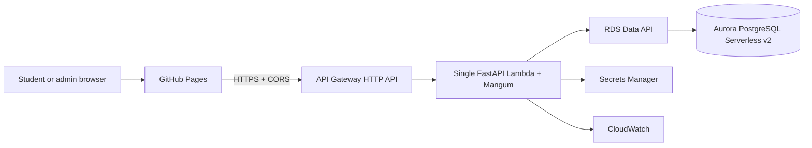
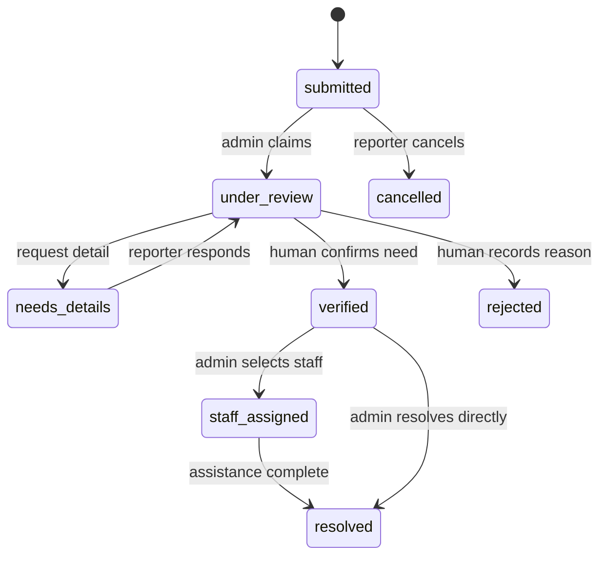

# Low-Cost AWS Demo: Campus Medical Assistance

* **Author:** Abhay Kumar
* **Status:** Approved architecture — ready for implementation planning
* **Date:** 2026-11-07
* **Purpose:** Cloud-computing course demonstration; not a production emergency service

## 1. Decision Summary

This replaces the previous Aurora + RDS Proxy + VPC design because its fixed
monthly cost is disproportionate for a supervised college demonstration. The
demo uses AWS Lambda and Aurora Serverless v2, but uses the **RDS Data API**
instead of database connections. It removes RDS Proxy, the VPC, interface
endpoints, AWS WAF, SQS, EventBridge, and external notification delivery.

Aurora PostgreSQL Serverless v2 uses a supported engine/Region, a minimum of
**0 ACUs**, a maximum of **1 ACU**, and automatic pause. The first request
after idle can take about 15 seconds while Aurora resumes. This is acceptable
for a supervisor-led demo, never for a claimed live emergency service.

### Review Feedback Resolution

| Review finding | Low-cost resolution |
| --- | --- |
| Data API multi-statement alert write | Use one Data API transaction for alert and audit writes; commit before completing the idempotency ledger. |
| Concurrent/retried client request | DynamoDB conditional ledger claim plus unique Aurora request key and lease recovery. No API Gateway authorizer is used because guest alerts must remain possible. |
| Concurrent admin edit | Versioned conditional update returns HTTP `409` on stale data. |
| Notification sweep race | Removed: notifications are synchronous simulated-log records; there is no SQS or scheduled sweep. |
| Aurora + RDS Proxy cost floor | Removed: Data API design has neither RDS Proxy nor VPC; Aurora can pause at 0 ACUs when supported. |
| WAF and rate-limit concern | Demo mitigation: API Gateway stage/route throttles plus FastAPI validation/rate limiting. A WAF is intentionally excluded and this is not positioned as DDoS-resistant production service. |

## 2. Scope

### In scope

* One-tap, minimal-detail medical alerts from GitHub Pages.
* Guest/authenticated submissions; admin review, verification, staff selection,
  rejection, and resolution.
* Campus locations, departments, hostels, wardens, and day/night caretakers.
* In-portal **simulated** staff/caretaker notification log after review.
* Durable audit history, DynamoDB-backed idempotent writes, and concurrent-admin
  protection.
* Lambda, API Gateway HTTP API, Aurora Serverless v2, Data API, DynamoDB,
  Secrets Manager, CloudWatch, and AWS CDK for Python.

### Deliberately out of scope

* Real SMS, email, WhatsApp, caregiver, ambulance, hospital, or dispatch
  integration.
* Attachments, malware scanning, a VPC, RDS Proxy, SQS, workers, WAF,
  multi-region recovery, and service-level availability guarantees.
* Automatic prank detection or medical decisions.

The interface must say **“Demo notification recorded”**, never “help has been
dispatched,” unless a human has personally made that call.

## 3. Architecture

**Figure 1.** One synchronous Lambda serves the API. There is no background
worker or external notification sender.

The Data API handles connectivity and database credentials through AWS APIs.
Lambda therefore needs no VPC path to Aurora and no RDS Proxy. With no proxy
connections, a supported Aurora version can pause at 0 ACUs. The trade-off is
a Data API repository layer rather than direct SQLAlchemy sessions.

## 4. Critical User Journeys

### CUJ 1 — Student requests medical help

1. Student chooses a campus location and taps **Get medical help**.
2. Frontend creates an idempotency key and sends only required fields.
3. Lambda conditionally claims the client key in a DynamoDB idempotency ledger
   before it calls Aurora. The ledger has `in_progress`, `completed`, and
   `failed` states, a 24-hour TTL, and the eventual alert reference.
4. Lambda starts one Data API transaction, writes the alert and audit event,
   commits, then marks the ledger `completed` with the reference.
5. A retry returns the completed result; a concurrent retry receives a bounded
   `409 Retry-After` response while the original request finishes. A stale
   in-progress claim can be recovered only after its lease expires.

### CUJ 2 — Admin verifies and coordinates help

1. Admin signs in and sees unreviewed alerts.
2. Admin claims it, contacts the reporter where appropriate, and marks it
   `verified`, `needs_details`, `rejected`, or `resolved`.
3. For verified alerts, admin selects suitable department/hostel staff,
   warden, or caretaker from the location map.
4. The transaction writes a simulated-notification record and audit event.
   During the demo, the admin personally contacts staff if needed.

### CUJ 3 — Admin avoids conflicting updates

Every editable alert carries an integer `version`. Admin updates include the
last-read version and use a conditional update that increments it only when it
still matches. A conflict returns HTTP `409`; the portal refreshes rather than
overwriting another administrator's work.

**Figure 2.** Human-reviewed alert lifecycle. Rejection preserves audit data.

## 5. Data and API Contracts

| Table | Purpose | Safeguard |
| --- | --- | --- |
| `users` | Admin/staff identity and roles | Password hashes only; bootstrap password changes at first login. |
| `medical_alerts` | Location, category, status, reporter context, version, request key | State validation, optimistic-lock version, and unique reporter-scope/key index. |
| `alert_events` | Append-only action timeline | Actor, action, timestamp, non-sensitive reason. |
| `notification_log` | Simulated notification records | Explicitly simulated; no external send. |
| `staff_directory` | Location-based staff and schedules | Admin-managed; contacts restricted to admins. |

**Table 1.** Durable demo records. Foreign keys, unique indexes, and database
transactions protect related writes. Alert creation writes the alert and event
in one Data API transaction. DynamoDB stores the retry/result ledger outside
that transaction; its lease-recovery path queries the unique request key after
a Lambda crash, then completes the ledger without creating another alert.
Staff assignment writes status, audit, and
simulation log together; no outbox is needed because there is no external send.

| Area | Contract | Demo behavior |
| --- | --- | --- |
| Create alert | `POST /medical-alerts` + `Idempotency-Key` | Minimal report; DynamoDB conditional claim prevents concurrent duplicates. |
| Guest follow-up | Alert-reference token route | Reporter can view only their alert. |
| Admin authentication | Login, refresh, logout | Server-side role checks. |
| Admin triage | Claim, verify, detail, assign, resolve, reject | Requires correct version and state transition. |
| Simulated notification | Assignment action | Creates portal log row only. |
| Health | `/health` | No credentials or data exposed. |

**Table 2.** Public API areas. FastAPI schemas limit field/body size and allow
only known campus locations.

## 6. AWS CDK (Python) Design

One stack creates:

* Aurora PostgreSQL Serverless v2, Data API enabled, 0–1 ACU range, supported
  engine version, and disposable demo deletion policy.
* DynamoDB on-demand idempotency ledger with 24-hour TTL; this replaces the
  previous database-only retry record.
* Secrets Manager database secret and separate JWT/alert-token secret.
* One container-image Lambda: FastAPI with Mangum.
* API Gateway HTTP API with exact GitHub Pages CORS origin, allowed methods and
  authorization/content-type/idempotency headers, access logs, and throttles.
* CloudWatch log group, Lambda-error alarm, and small AWS Budget alert.

### Runtime Limits and Abuse Controls

The API Gateway HTTP API integration timeout is **29 seconds** and Lambda is
configured for **28 seconds**. Lambda makes at most two short, jittered retries
for transient Aurora-resume/Data API errors while enough execution time remains.
The frontend shows a retry message rather than claiming an alert was received
after a timeout.

API Gateway has a **10 requests/second** stage throttle and **20-request burst**
limit. `POST /medical-alerts` has a 5 requests/second, 10-request burst route
limit. FastAPI additionally limits each client IP to 3 guest alerts/minute, 5
login attempts/15 minutes, and 60 reads/minute. Gateway throttles are global or
route-level; FastAPI supplies per-IP limits. These are demo safeguards, not
WAF-grade DDoS protection.

Only `ApiBaseUrl` is a stack output. GitHub Actions writes it to
`frontend/config.js`; no secret reaches GitHub Pages.

## 7. Application Changes

1. Add a Mangum Lambda handler around FastAPI.
2. Replace production SQLAlchemy sessions with a repository layer using Data
   API `BeginTransaction`, parameterized `ExecuteStatement` calls carrying the
   returned `transactionId`, and `CommitTransaction`. Alert, audit event, and
   unique request-key writes share one transaction; an error calls
   `RollbackTransaction`. The demo uses no stored procedure. Keep local tests
   behind the same repository interface where practical.
3. Add a DynamoDB conditional idempotency-claim service with 24-hour TTL,
   lease recovery, and stored completed result; add versioned conditional
   mutations to Aurora records.
4. Replace SQS/SNS worker calls with synchronous simulated-notification logging.
5. Disable attachment controls until a reviewed scanning design is funded.
6. Retain FastAPI validation/rate limiting and API Gateway HTTP API stage and
   route throttles as basic cost/abuse controls. Do not claim WAF-level DDoS
   protection for this demo.

### Bootstrap Administrator Safety

CDK creates a one-time Secrets Manager bootstrap secret with a random temporary
password and `expires_at` set to 24 hours after deployment. The setup command
accepts it once, activates the named administrator, requires an immediate
password change, and records it as consumed. After consumption or expiry, the
command rejects it and an operator deletes the secret. Secret values never
appear in CDK outputs, logs, or GitHub Actions.

## 8. Deployment and Demo Runbook

1. Choose a Region/engine combination supporting Data API and 0-ACU auto-pause.
2. Run unit, Data API repository, migration, and `cdk synth` tests.
3. Deploy CDK; run Alembic once using a dedicated migration invocation, never
   during an API request.
4. Create bootstrap admin from a one-time secret and change its password on
   first login.
5. Put `ApiBaseUrl` in GitHub Actions variable `API_BASE_URL`, deploy Pages,
   and test browser CORS.
6. Demonstrate guest alert → admin review → staff selection → simulated log →
   resolution → audit history.
7. Destroy the disposable stack after the demo to prevent ongoing charges.

## 9. Verification

1. A duplicate or concurrent alert retry claims one DynamoDB ledger record and
   returns one alert reference.
2. Two stale concurrent admin updates yield one success and one HTTP `409`.
3. A rejected alert keeps its audit history.
4. Staff selection records a simulated notification and sends no external call.
5. CORS permits only GitHub Pages; API Gateway throttles and application rate
   limits reject a synthetic burst; non-admins cannot take admin actions.
6. Operator tests one cold-resume request and knows to retry once after idle.
7. Pages, Lambda, and Aurora Data API complete CUJ 1 and CUJ 2 end to end.

### Load and Resilience Test

Use synthetic campus locations and no real contacts. First, execute one
cold-resume alert and record time to success. After Aurora is warm, send 10
create-alert requests/second for 60 seconds, each with a unique idempotency
key, then repeat selected keys concurrently. Acceptance is at least 95%
successful responses after warm-up, exactly one alert per repeated key, no
Lambda timeout, and no duplicate audit event. A second test runs two concurrent
versioned admin updates and must produce one success and one `409`.

## 10. Cost Boundary

The target is **low single-digit monthly spend while mostly idle**, plus Aurora
storage, Secrets Manager, and CloudWatch logs. Exact costs depend on Region and
time spent awake; they are not guaranteed to be zero. Data API includes a
first-year one-million-request monthly free tier, but other services can charge.
Use the AWS Pricing Calculator before deploying and set a strict budget alert,
for example USD 10.

If the calculator exceeds the approved cap, do not deploy. Use local
development/screenshots for the presentation or obtain approval for another
managed database; do not reintroduce expensive components for this demo.

## Appendix A — Demo Cost Estimate

This is a planning estimate for one mostly-idle demo environment, not a quote.
It assumes a supported Aurora configuration that reaches 0 ACU, less than 1 GB
of database data, fewer than 10,000 Data API calls/month, no attachments or
real notifications, and teardown after the presentation.

| Service | Planning cost | Why |
| --- | ---: | --- |
| Aurora compute | $0 while paused; variable while awake | 0-ACU pause removes the former 0.5-ACU floor. |
| Aurora storage/I/O | $0–2 | Small, Region-dependent demo database. |
| Data API | $0 in first-year free tier at this volume | First 1 million requests/month are included for one year. |
| Lambda and HTTP API | $0–2 | Small traffic; free-tier eligibility is account-specific. |
| Secrets Manager and CloudWatch | $1–5 | Two secrets, limited logs, and one alarm. |
| DynamoDB ledger | $0–1 | On-demand, low-volume traffic with TTL cleanup. |
| **Expected total** | **$1–10/month** | Excludes tax and cost of leaving the stack running. |

Validate the selected Region in the AWS Pricing Calculator before deployment,
set a **USD 10 monthly budget alert**, and destroy the stack after the demo.
The calculator, not this estimate, is the deployment approval source.

## 11. Glossary

| Term | Meaning |
| --- | --- |
| ACU | Aurora Capacity Unit, Aurora Serverless v2 compute capacity. |
| API Gateway HTTP API | Low-cost HTTPS entry point for Lambda. |
| AWS CDK | Python infrastructure code that creates AWS resources. |
| Data API | HTTPS database API for Aurora; avoids direct database connections. |
| DynamoDB | AWS key-value database used here as a short-lived idempotency ledger. |
| Idempotency key | Unique client key making a retry return one result. |
| Mangum | Adapter that runs FastAPI in Lambda. |
| Optimistic locking | Version check that rejects stale concurrent updates. |
| Simulated notification | In-app demo record; no external message is sent. |

## Sources

* [Aurora auto-pause and resume](https://docs.aws.amazon.com/AmazonRDS/latest/AuroraUserGuide/aurora-serverless-v2-auto-pause.html)
* [Aurora Serverless v2 capacity configuration](https://docs.aws.amazon.com/AmazonRDS/latest/AuroraUserGuide/aurora-serverless-v2.create.html)
* [Aurora Data API pricing](https://aws.amazon.com/rds/aurora/pricing/)
* [HTTP API CORS](https://docs.aws.amazon.com/apigateway/latest/developerguide/http-api-cors.html)

---

*Drafted with EGM and revised for a low-cost course demonstration.*
