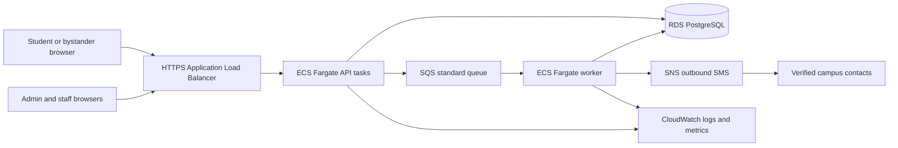

# Cloud Architecture: Campus Medical Assistance

## What the project demonstrates

One tap from a browser creates a durable alert in a cloud database. The admin portal polls for it, while a separate worker sends staff notifications and escalates an unacknowledged alert after the configured deadline. The database records every action and delivery state so worker restarts do not erase pending work.

## Responsibilities

| Component | Role |
|---|---|
| ECS API | Serves student, admin, and staff interfaces and writes alerts, events, and notification jobs. |
| RDS PostgreSQL | Authoritative alert state, campus coverage, duty contacts, messages, and delivery attempts. |
| SQS standard queue | Wakeup messages for notification jobs; the worker also scans RDS so a missed queue publish does not lose an alert. A standard queue is required for per-message delay. |
| ECS worker | Processes due RDS jobs, checks whether an admin has acknowledged before backup escalation, retries transient failures, and reports permanent failure. |
| SNS | Optional approved SMS delivery when `NOTIFICATION_MODE=sns`; no medical details are put in messages. |
| CloudWatch | API/worker logs and alarms for worker failures, failed jobs, and requests that remain unacknowledged. |

## Deployment sequence

1. Create private RDS PostgreSQL, ECS services in private subnets, HTTPS ALB, ECR repository, CloudWatch log groups, and an SQS **standard** queue with a dead-letter queue. Configure RDS backups and network rules so only ECS tasks can access it.
2. Place `JWT_SECRET` and `DATABASE_URL` in Secrets Manager. Supply a verified campus emergency phone, backup number, AWS region, and SQS URL. Give ECS task role only the necessary SQS send/receive/delete and SNS publish permissions.
3. Build the Docker image. Run `python -m alembic upgrade head` once against RDS as a deployment task. The Docker image includes `migrations/` and `alembic.ini`.
4. Deploy the API via `ecs-task-definition.json` and `ecs-service.json`, and the worker via `ecs-worker-task-definition.json` and `ecs-worker-service.json`. Replace placeholder ARNs, subnet IDs, security groups, queue URL, phone numbers, and image URI.
5. Create an admin account with `python -m app.cli create-admin ...` in a protected task session. Add real staff contacts, shifts, and place coverage in the portal. Run a controlled alert and verify its acknowledgement, staff delivery, missed-admin escalation, and failure reporting.
6. Add CloudWatch alarms for API health, worker task count, SQS dead-letter messages, and failed notification jobs. The portal's operations badge remains a setup check, not a substitute for these alarms.

## Failure semantics

- The request is successful only after RDS commits it. A network error on submission must show a failure and a direct call route.
- If SQS publish fails, the persisted RDS job remains and the worker's periodic scan processes it.
- If an admin acknowledges before the deadline, the backup job is cancelled when the worker checks it.
- Local `simulation` mode writes `simulated`; it never writes `sent`. Missing backup number or staff phone writes `failed`. SNS exceptions are retried up to three times, then shown as failed.
- The API and worker do not contain a medical diagnosis or automatic prank classifier. Only a human admin may close a false report, with a reason.

## Scope of verification

Automated tests cover local API, permissions, migration, and worker behavior. Real SNS delivery, SQS IAM permissions, telecom regulations, and duty coverage require the college's AWS account and verified contacts; these cannot be proven by local tests. The project should remain labeled a prototype until those checks pass.
